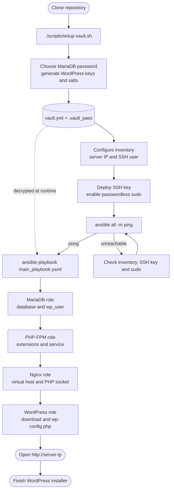

# LEMP Stack & WordPress Deployment with Ansible

Automated, modular Ansible playbook for deploying a high-performance **LEMP Stack (Linux, Nginx, MariaDB, PHP-FPM)** and an optimized **WordPress** installation on Debian/Ubuntu-based servers.

---

## 🗺️ Deployment Flow



---

## 📋 Features

- **MariaDB Role (`roles/mariadb`)**:
  - Installs MariaDB server and Python MySQL bindings (`python3-pymysql`).
  - Ensures the service is enabled and running.
  - Hardens database security (removes anonymous users and test database).
  - Automatically provisions the WordPress database, dedicated application user, and grant privileges.

- **PHP-FPM Role (`roles/php`)**:
  - Installs PHP-FPM along with essential WordPress extensions (`cli`, `common`, `mysql`, `curl`, `gd`, `intl`, `mbstring`, `soap`, `xml`, `zip`, `imagick`, `bcmath`).
  - Configurable for native distro packages (e.g. PHP 8.5 on Ubuntu 26.04) or external PPA (`ppa:ondrej/php`).
  - Automatically manages and reloads the PHP-FPM service.

- **Nginx Role (`roles/nginx`)**:
  - Installs and enables Nginx.
  - Disables default virtual host site.
  - Deploys a customized virtual host for WordPress using Unix socket connection to PHP-FPM.
  - Configures clean URL routing (`try_files`), security headers/rules (`.ht*` protection), and static asset caching.

- **WordPress Role (`roles/wordpress`)**:
  - Automatically downloads and extracts the latest official WordPress release.
  - Creates the web root directory with proper user/group permissions (`www-data`).
  - Dynamically renders `wp-config.php` with database credentials, table prefix, and unique security keys/salts.
  - Ensures correct file ownership and permissions across the entire document root.

---

## 📁 Project Structure

```text
LEMP-Deployment/
├── ansible.cfg                 # Ansible configuration (inventory path, vault pass)
├── group_vars/
│   └── all/
│       ├── vars.yml            # Global non-secret variables
│       ├── vault.yml.example   # Template for local secrets
│       └── vault.yml           # Encrypted secrets (local, gitignored)
├── host_vars/
│   └── anyhost.yaml            # Host-specific overrides (optional)
├── inventory/
│   └── hosts.yml               # Target servers inventory definition
├── main_playbook.yaml          # Main playbook execution entry point
├── scripts/
│   └── setup-vault.sh          # Creates the local encrypted vault
├── roles/
│   ├── mariadb/
│   │   ├── defaults/main.yml   # Default variables for MariaDB
│   │   └── tasks/main.yml      # MariaDB provisioning tasks
│   ├── nginx/
│   │   ├── defaults/main.yml   # Default variables for Nginx
│   │   ├── handlers/main.yml   # Nginx reload/restart handlers
│   │   ├── tasks/main.yml      # Nginx provisioning tasks
│   │   └── templates/
│   │       └── wordpress.conf.j2 # Nginx VirtualHost Jinja2 template
│   ├── php/
│   │   ├── defaults/main.yml   # Default variables for PHP-FPM
│   │   ├── handlers/main.yml   # PHP-FPM restart handlers
│   │   └── tasks/main.yml      # PHP-FPM provisioning tasks
│   └── wordpress/
│       ├── defaults/main.yml   # Default variables for WordPress
│       ├── tasks/main.yml      # WordPress installation tasks
│       └── templates/
│           └── wp-config.php.j2 # wp-config.php Jinja2 template
└── README.md
```

---

## ⚙️ Prerequisites

### Control Node (Your Machine)
- **Ansible** (`ansible-core` >= 2.15)
- **SSH Client**
- **SSH key pair** for the Ansible user (password-based SSH is not configured in the inventory)

### Managed Target Node(s)
- **Operating System**: Ubuntu 22.04 / 24.04 / 26.04 or Debian 11 / 12.
- **SSH access** with a user that has `sudo` privileges.
- *Recommended*: Passwordless sudo configured for the Ansible user (`user ALL=(ALL) NOPASSWD:ALL`) in `/etc/sudoers.d/ansible_user`.

---

## 🚀 Quick Start

### 1. Clone and Generate Secrets
```bash
git clone https://github.com/ibra-root/LEMP-Deployment.git
cd LEMP-Deployment
./scripts/setup-vault.sh
```

The script asks for two things:

- The **MariaDB password** for `wp_user` (press Enter to generate a random one).
- The **passphrase** that encrypts your local vault (press Enter to generate one).

It then creates:

- `group_vars/all/vault.yml` — encrypted secrets: database password and the eight WordPress authentication keys/salts.
- `.vault_pass` — the vault passphrase, with mode `0600`.

Both files are local and ignored by git: **never commit them**. The WordPress keys/salts are generated automatically; you only choose the database password (or let the script generate it).

Manage the secrets later with:

```bash
ansible-vault edit group_vars/all/vault.yml   # edit the encrypted secrets
ansible-vault view group_vars/all/vault.yml   # show the encrypted secrets
```

`ansible.cfg` points to `.vault_pass`, so `ansible` and `ansible-playbook` work without extra exports. If you prefer not to store the passphrase on disk, comment out `vault_password_file` in `ansible.cfg` and use `--ask-vault-pass`.

Manual alternative without the script:

```bash
cp group_vars/all/vault.yml.example group_vars/all/vault.yml
# edit the values in group_vars/all/vault.yml

# create the local passphrase file (mode 0600)
printf '%s\n' 'TU_PASSPHRASE' > .vault_pass
chmod 600 .vault_pass

# ansible.cfg already points to .vault_pass
ansible-vault encrypt group_vars/all/vault.yml
```

### 2. Configure the Inventory
[`inventory/hosts.yml`](inventory/hosts.yml) contains **no credentials**: authentication relies on SSH keys and passwordless `sudo`:

```yaml
all:
  vars:
    ansible_user: user
    # ansible_ssh_private_key_file: ~/.ssh/id_ed25519  # if not the default key
  hosts:
    nodo1:
      ansible_host: 192.168.1.134
```

Prepare the target node once:

```bash
# Create a key if you don't have one yet
ssh-keygen -t ed25519 -f ~/.ssh/id_ed25519

# Copy it to the server
ssh-copy-id -i ~/.ssh/id_ed25519.pub user@192.168.1.134

# Allow passwordless privilege escalation
ssh -t user@192.168.1.134 \
  'echo "user ALL=(ALL) NOPASSWD:ALL" | sudo tee /etc/sudoers.d/ansible_user && sudo chmod 0440 /etc/sudoers.d/ansible_user'
```

Verify that Ansible can connect without being asked for a password before running the playbook.

### 3. Customize Application Variables
Review and modify non-secret global variables in [`group_vars/all/vars.yml`](group_vars/all/vars.yml):

```yaml
# Domain and Web Root
server_name: "_"
app_dir: /var/www/wordpress

# Nginx
nginx_port: 80

# PHP Version (e.g. 8.5 for Ubuntu 26.04, 8.3 for Ubuntu 24.04)
php_version: "8.5"
php_fpm_user: www-data
php_fpm_group: www-data

# MariaDB Credentials
db_name: wordpress_db
db_user: wp_user
db_password: "{{ vault_db_password }}"   # actual value lives in vault.yml
db_host: localhost

# WordPress Table Prefix
wp_table_prefix: "wp_"
```

### 4. Verify Connection
Test connectivity to your managed hosts:

```bash
ansible all -m ping
```

### 5. Run the Playbook
Deploy the full LEMP stack and WordPress with:

```bash
ansible-playbook main_playbook.yaml
```

Once completed, open your browser and navigate to `http://<TARGET_HOST_IP>` (e.g., `http://192.168.1.134`) to finish the WordPress web installer.

---

## 🧰 Ansible Commands

Run these commands from the repository root; `ansible.cfg` already points to the inventory and vault passphrase file.

| Command | Action |
| :--- | :--- |
| `./scripts/setup-vault.sh` | Generates `group_vars/all/vault.yml` and `.vault_pass`. |
| `ansible all -m ping` | Checks connectivity to the managed hosts. |
| `ansible-playbook main_playbook.yaml --syntax-check` | Validates the playbook syntax. |
| `ansible-playbook main_playbook.yaml` | Runs the full deployment. |
| `ansible-vault edit group_vars/all/vault.yml` | Opens the encrypted secrets in `$EDITOR`. |
| `ansible-vault view group_vars/all/vault.yml` | Prints the encrypted secrets. |

---

## 🔧 Variables & Role Customization

Deployment-wide and cross-role variables (database names, web root, PHP version, Nginx port, etc.) are defined once in [`group_vars/all/vars.yml`](group_vars/all/vars.yml). Role `defaults/main.yml` files only contain role-internal values (package lists, service names, internal paths), which can still be overridden from `group_vars` when needed. Secrets are never defined in role defaults.

| Variable | Default Value | Description |
| :--- | :--- | :--- |
| `server_name` | `"_"` | Domain name or IP for Nginx server block (`server_name`). |
| `app_dir` | `/var/www/wordpress` | Directory path where WordPress is extracted and served. |
| `nginx_port` | `80` | HTTP listening port for Nginx. |
| `php_version` | `"8.5"` | PHP major.minor version used for packages and socket path. |
| `php_use_ppa` | `false` | Set `true` to enable Ondřej Surý PPA on supported Ubuntu versions. |
| `db_name` | `wordpress_db` | Name of the MariaDB database for WordPress. |
| `db_user` | `wp_user` | Database user created with permissions on `db_name`. |
| `db_password` | `vault_db_password` (encrypted) | Password for the database user. Defined in `group_vars/all/vault.yml`. |
| `db_host` | `localhost` | Database host (defaults to local socket/connection). |
| `wp_table_prefix`| `"wp_"` | Database table prefix for WordPress tables. |
| `wp_auth_key`, `wp_*_salt`, ... | encrypted (`vault_wp_*`) | WordPress authentication keys and salts. Defined in `group_vars/all/vault.yml`. |

---

## 🛠️ Troubleshooting & Notes

- **Privilege Escalation on Modern Ubuntu (26.04+ / `sudo-rs`)**:
  Ubuntu 26.04 utilizes `sudo-rs` by default. To ensure reliable non-interactive privilege escalation, configure `NOPASSWD` for the Ansible user on the remote host:
  ```bash
  echo "user ALL=(ALL) NOPASSWD:ALL" | sudo tee /etc/sudoers.d/ansible_user
  sudo chmod 0440 /etc/sudoers.d/ansible_user
  ```

- **SSH Keys Authentication**:
  The inventory intentionally contains no passwords. Deploy your SSH public key and enable passwordless `sudo` as described in [Quick Start](#-quick-start). Do not add `ansible_password` or `ansible_become_password` back to the inventory.

- **Rotating Secrets**:
  Edit the values with `ansible-vault edit group_vars/all/vault.yml` and re-run the playbook. Changing `vault_db_password` updates the MariaDB user password; rotating the WordPress keys/salts re-renders `wp-config.php` and invalidates existing login sessions. If a secret was ever committed or shared, rotate it — encrypting it afterwards does not remove it from Git history.

- **Local Secret Files**:
  `group_vars/all/vault.yml` and `.vault_pass` are created per installation and ignored by git. Run `git check-ignore -v group_vars/all/vault.yml .vault_pass` to confirm. Commit only `group_vars/all/vault.yml.example`. If the vault passphrase is lost, the encrypted file cannot be recovered.

---

## 📄 License

This project is open-source and licensed under the terms of the [MIT License](LICENSE).
